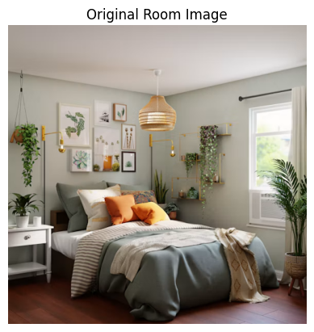

# Room Style Transfer Assistant 🏠

## Project Overview
Room Style Transfer Assistant is an AI-powered application that transforms room images into different interior design styles using Image-to-Image Diffusion technology and the pre-trained Stable Diffusion model.

## Project Objective
The main objective is to explore the capabilities of Generative AI in interior design by transforming existing room images into creative design alternatives.

## Technologies Used
- Python
- PyTorch
- Stable Diffusion
- Hugging Face Diffusers
- Gradio
- Google Colab

## Key Features
- Upload a room image.
- Choose an interior design style.
- Customize image transformation settings.
- Generate redesigned room images.
- Interactive user interface.

## Implementation
The project uses a pre-trained Stable Diffusion Image-to-Image pipeline to generate new room designs based on text prompts and uploaded images.

## Future Improvements
- Add more interior design styles.
- Improve image consistency.
- Enhance preservation of room structure.
- Optimize generation performance.

## Author
Developed as a practical Artificial Intelligence and Computer Vision project.

## Before and After

### Original Room

### AI-Generated Design

